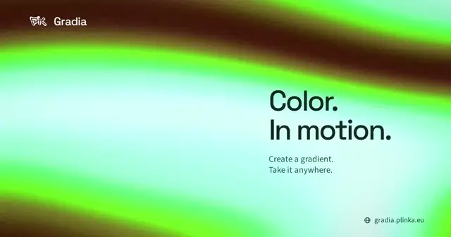

# Gradia

**Make a gradient. Make it move. Take it anywhere.**

A fullscreen WebGL gradient studio by [Plinka](https://plinka.eu). Explore 32 presets, shape the motion, stack GPU effects, then copy your **exact current preset** into React or JavaScript.

[Open Gradia](https://gradia.plinka.eu) · [Integration guide](docs/integration.md) · [Architecture](docs/architecture.md) · [For AI agents](docs/agents.md)

[](https://gradia.plinka.eu/media/gradia-preview.mp4)

[Watch the lightweight video](docs/media/gradia-preview.webm) · [MP4 version](docs/media/gradia-preview.mp4)

## What you can do

- Start with **32 curated presets** or generate four fresh variations at a time.
- Explore **Mesh, Silk, Aurora, Liquid, Radial and Waves**.
- Reorder up to six colors; adjust composition, motion, contrast, hue, grain and chromatic dispersion.
- Blend between **two live shader renders**, including their colors and GPU effects.
- Stack **GPU ASCII, dithering, Blocks, Glass and Folds** with independent settings.
- Reorder effects, adjust opacity, and choose 26 blend modes or 13 alpha operations.
- Scrub a deterministic **1–30 second seamless loop**.
- Save named presets locally, with real WebGL thumbnails and undo/redo.
- Export PNG, WebM, MP4 or versioned JSON; choose any aspect ratio.
- Copy React, JavaScript, JSON or an **AI agent prompt containing your current configuration**.
- Use the portable TypeScript sources or the **prebuilt, dependency-free minified engine**.

The studio uses React, TypeScript, Jotai, Motion and shadcn Base UI. The engine uses plain WebGL and has no dependency on the studio.

## Use your gradient

1. Open [Gradia](https://gradia.plinka.eu), create your gradient, then select **Code**.
2. Choose **React / JavaScript / JSON** and **Minified JS / Source**.
3. Download the kit, copy the corresponding folder into your project, and paste the generated code.

**Prebuilt:** copy the kit's `gradia/` folder. JavaScript needs only `gradia/min-js/gradia.min.js`. React also uses `gradia-react.min.js` and your existing React installation. TypeScript declarations are included.

```tsx
"use client";
import { Gradient } from "./gradia/min-js/gradia-react.min.js";
import { presets } from "./gradia/min-js/gradia.min.js";

export function Background() {
  return <Gradient config={presets[0].config} style={{ width: "100%", height: "100dvh" }} />;
}
```

**Sources:** copy `gradient/` instead. Core data, the WebGL renderer and the React adapter are separate. No UI, Jotai or Motion is required. [Detailed examples →](docs/integration.md)

`package/` is the prebuilt distribution in this repository; it is **not published on npm**. You can also install it locally with `bun add ./path/to/Gradia/package`.

## Run the studio

```sh
bun install --frozen-lockfile
bun run dev
```

Open **http://localhost:8410**. To regenerate the downloadable kit before a production build:

```sh
bun run build
```

The build produces `dist/`, the reusable `package/min-js/` modules, TypeScript declarations and `gradia-kit.zip`. Python 3 only assembles the ZIP; it is not a runtime dependency.

## Engine at a glance

```ts
import { GradientRenderer, presets } from "./gradia/min-js/gradia.min.js";

const gradient = new GradientRenderer(canvas, { config: presets[0].config });
gradient.update({ contrast: 1.2 }); // continuous controls, coalesced per frame
gradient.transitionTo(presets[4].config); // smooth GPU blend to Silk
// Call gradient.destroy() when your component or page is disposed.
```

The gradient-only pipeline uses two draw calls. Each active effect adds one GPU pass, including its blend and alpha composition. Animation and the timeline stay outside React's render cycle. Jotai subscriptions isolate individual controls and colors. Live transitions render both complete stacks and preserve their visible GPU composite across interruptions.

[Architecture and performance notes →](docs/architecture.md)

## AI agent integration

Read [docs/agents.md](docs/agents.md), or use **Code → Copy AI agent prompt** in Gradia. That prompt contains the actual preset and the exact integration paths. Avoid recreating the renderer per frame or copying the editor UI into your app.

## Validation and deployment

```sh
bun run typecheck
bun run lint
bun run test:coverage
bun run build
bun run test:e2e
bun run deploy:check
```

Core coverage is enforced independently across statements, branches, functions and lines. Browser tests verify actual GPU pixels, seamless loops, exports, code integration and editor behavior. GPU/UI coverage is behavioral, not a claim of full instrumented GPU coverage.

Deployment is a static Cloudflare Worker at **gradia.plinka.eu**. GitHub Actions deploys only `main` in `ExtraBinoss/Gradia`, only when both actor and triggering actor are `ExtraBinoss`. Cloudflare credentials are GitHub secrets and never enter the frontend build. [Deployment details →](docs/deployment.md)

## Credits

Original Gradia engine and shaders: MIT. Third-party components retain their own terms; see [THIRD_PARTY_NOTICES.md](THIRD_PARTY_NOTICES.md). The showcase video derives from the supplied Gradia capture; the PK is the Plinka brand asset.

## Social preview and showcase media

The English 1200×630 Open Graph card is authored in `artwork/social/index.html`, using the real Gradia recording, local product fonts and the original Plinka PK. Run `bun run assets:social` to reproduce it. Metadata is present in the initial HTML. `python3 scripts/prepare-media.py <recording.webm>` prepares the branded video, matching poster and animated README preview; FFmpeg is only needed for this optional media task.

## Stackable GPU effects

The studio has a separate effect stack: **ASCII, Dither, Blocks, Glass and Folds**.
Select an effect to edit it, drag to reorder, adjust opacity, and choose from 26 blend modes
and 13 alpha compositing operators. The gradient remains the source. All effects run in
WebGL and survive presets, JSON, copied React/JS, PNG and deterministic video exports.
Download the kit from the same app instance that produced your preset.

The standalone `EffectPass` and `TextureCompositePass` also work with your own WebGL
textures. See [the integration examples](docs/integration.md#compose-an-effect-stack).
